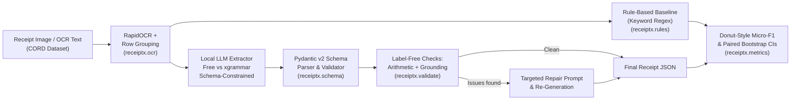

# LLM Structured Receipt Extraction (`receiptx`)

Structured field extraction from noisy OCR receipt text on **CORD** using small local LLMs (`Qwen2.5-1.5B-Instruct` & `Qwen2.5-0.5B-Instruct`): **RapidOCR** line reconstruction, **free vs. xgrammar schema-constrained decoding**, **label-free arithmetic & source-grounding validators**, and a **targeted repair loop**, benchmarked against a deterministic rule-based baseline.

## Problem Statement

Extracting structured line items and financial totals from real-world receipts is a classic production GenAI problem where naive prompting fails in predictable ways:

1. **Malformed JSON & schema drift**: Small local LLMs (0.5B–1.5B) frequently emit extra keys, markdown fences, or truncated JSON when unconstrained.
2. **Hallucinated amounts & arithmetic inconsistencies**: Even schema-valid JSON can contain numbers that never appeared in the OCR text or line items that fail to sum to the subtotal/total.
3. **Human-in-the-loop routing**: In production, labels do not exist at inference time. Label-free arithmetic and grounding checks can both trigger automated repair and predict which receipts need human review.

## Architecture



## Key Capabilities

- **Strict CORD Schema (`receiptx.schema`)**: Pydantic v2 `Receipt` and `Item` models with `extra="forbid"`, preserving receipt reading order and exposing a fully-required JSON Schema for constrained decoding.
- **OCR Line Reconstruction (`receiptx.ocr`)**: Groups RapidOCR bounding boxes into reading-order lines by vertical overlap and horizontal spacing.
- **Deterministic Rule Baseline (`receiptx.rules`)**: Keyword-pattern extractor targeting all 8 summary fields (`subtotal_price`, `discount_price`, `service_price`, `tax_price`, `total_price`, `cashprice`, `creditcardprice`, `changeprice`), handling next-line amounts and quantity exclusions.
- **Constrained Local LLM Decoding (`receiptx.llm`, `receiptx.prompts`)**: Supports free generation and `xgrammar` JSON-schema-constrained decoding with optional 1-shot prompting and error-driven repair prompts.
- **Label-Free Verification (`receiptx.validate`)**:
  - `arithmetic()`: Checks line-item sums against subtotal/total (supporting both tax-inclusive and tax-exclusive receipts) and `cashprice - total_price == changeprice`.
  - `grounding()`: Verifies every extracted item name and numeric amount appears in the source OCR text.
- **Donut-Style Evaluation (`receiptx.metrics`, `receiptx.run`)**: Flattens receipts to `(field, value)` multisets with strict and normalized (separator-invariant) micro-F1, per-field precision/recall, paired bootstrap 95% CIs, and label-free error-detection precision/recall.

## Benchmark Results

### Observed CORD `test` Split Results (from `results/test/summary.json`, 100 receipts)

One-shot example selected deterministically from training split: `train-0069`.

| System | Metric Mode | Micro-F1 (95% CI) | Precision | Recall | JSON Parse | Schema Valid | Summary-Only F1 |
| :--- | :--- | :---: | :---: | :---: | :---: | :---: | :---: |
| `rules` (OCR) | Normalised | **0.3298** `[0.2925, 0.3729]` | 0.8509 | 0.2045 | 100.0% | 100.0% | **0.7370** |
| `rules` (OCR) | Strict | **0.2903** `[0.2533, 0.3319]` | 0.7491 | 0.1801 | 100.0% | 100.0% | — |

#### Per-Field Breakdown (`rules` on CORD `test`, normalised)

| Field | Gold Count | Precision | Recall |
| :--- | :---: | :---: | :---: |
| `subtotal_price` | 65 | 0.925 | 0.754 |
| `total_price` | 95 | 0.842 | 0.674 |
| `cashprice` | 67 | 0.868 | 0.687 |
| `creditcardprice` | 16 | 0.846 | 0.688 |
| `tax_price` | 43 | 0.848 | 0.651 |
| `service_price` | 12 | 0.727 | 0.667 |
| `changeprice` | 56 | 0.844 | 0.482 |
| `discount_price` | 6 | 0.250 | 0.167 |
| `menu.*` (line items) | 784 | — | 0.000 *(summary-only baseline)* |

#### Local CPU Smoke Timing (from `run.log`)

- `qwen1.5b-free` (`Qwen/Qwen2.5-1.5B-Instruct`) on first 6 `test` receipts (`test-0000`–`test-0005`, CPU): **6/6 `schema_ok=True`**, 69–178 generated tokens/receipt, 48.4s–137.3s/receipt. Full 100-receipt LLM + constrained + repair sweeps are pre-registered in `receiptx.run.CONFIGS` and resume automatically from `results/test/predictions/`.

## Quickstart

```bash
# Install core package + dev tools
pip install -e ".[dev]"

# Optional: install local LLM (xgrammar/torch) and OCR extras
pip install -e ".[llm,ocr]"

# Run unit tests
pytest

# Run OCR over CORD splits
receiptx-ocr --out data/ocr

# Run extraction & evaluation configs (resumes per receipt)
receiptx-run --split test --out results --configs rules,qwen1.5b-constrained-1shot,qwen1.5b-constrained-1shot-repair
```

## Project Structure

```text
src/receiptx/
├── schema.py   # Pydantic v2 Receipt/Item schema & full JSON Schema
├── data.py     # CORD dataset loader & gold receipt normalization
├── ocr.py      # RapidOCR runner & spatial bounding-box line grouping
├── rules.py    # Deterministic keyword baseline for summary fields
├── prompts.py  # Extraction, 1-shot, and validation-repair prompts
├── llm.py      # Local HuggingFace + xgrammar constrained decoding & parser
├── validate.py # Label-free arithmetic & source-grounding checks
├── metrics.py  # Donut-style micro-F1, normalization, paired bootstrap CIs
└── run.py      # Resumable experiment runner & summary generator
tests/
└── test_core.py
```

## License

MIT — see [LICENSE](LICENSE).
